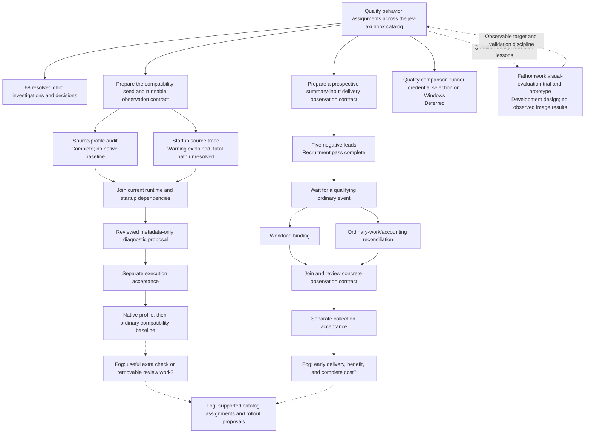

# System One research frontier

The current map has 71 children: 68 closed and three open. Solid arrows show
work sequence; dotted arrows show knowledge exchange or unresolved possibilities.
Only the tracker carries canonical issue dependencies.

- [Catalog map](https://github.com/nisavid/provingkit/issues/331)
- [Compatibility preparation](https://github.com/nisavid/provingkit/issues/471)
- [Summary-delivery preparation](https://github.com/nisavid/provingkit/issues/695)
- [Deferred Windows qualification](https://github.com/nisavid/provingkit/issues/530)
- [Fathomwork trial](https://github.com/nisavid/fathomwork/issues/121) and
  [prototype](https://github.com/nisavid/fathomwork/issues/122)

The completed predecessor map,
[Learn from Sys1 incidents and qualify the first correction](https://github.com/nisavid/provingkit/issues/229),
remains closed. Its bounded correction is evidence, not full-catalog qualification.
